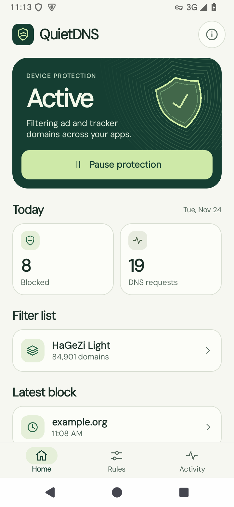
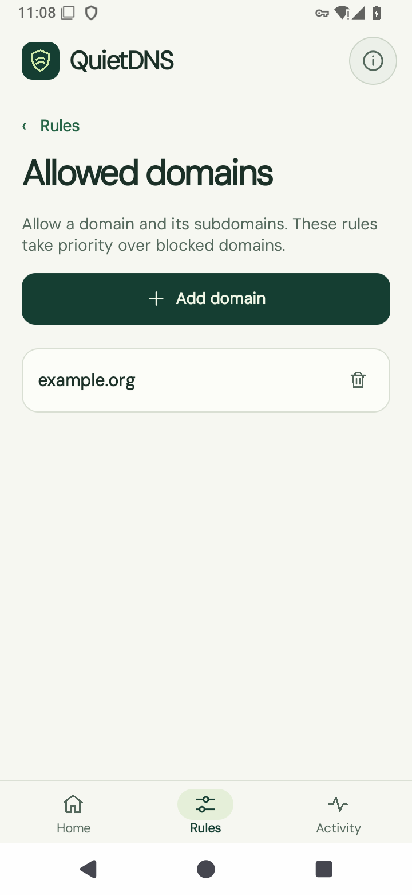

# QuietDNS

QuietDNS blocks known ad and tracker domains across Android apps and browsers. It runs on your phone using Android’s local VPN feature, with no root, account, or subscription required. It supports the Samsung Galaxy A56 and other ARM64 phones running Android 10 or later.

**[Download QuietDNS 1.0 for Android (APK)](https://github.com/touseefeli/QuietDNS/releases/download/v1.0/QuietDNS-1.0.apk)** · [Release notes and checksum](https://github.com/touseefeli/QuietDNS/releases/tag/v1.0)

## Install on a Galaxy A56

1. Download the APK to your phone, open it, and choose **Install**. If Android asks, allow installation from the app you used to open the file.
2. Open **QuietDNS**, tap **Turn on protection**, and approve Android’s VPN connection request. The notification permission enables a persistent pause control.
3. When the home screen shows **Active**, browse normally. **Activity** lists recent blocks. Tap an entry to allow a domain, or manage it under **Rules**.
4. Use **Rules → Check for updates** to refresh the bundled filter. The last valid list stays available offline.

<p>
  
  
</p>

Version 1.0 includes 84,901 domain rules. The screenshots show a custom rule for `example.org` used to test blocking and allowing the same domain on an Android 15 emulator.

## Coverage and privacy

The VPN routes only a single virtual IPv4 DNS endpoint to the app. The endpoint handles both A and AAAA questions, over UDP or TCP, including on IPv6-capable networks. Android handles ordinary internet traffic. Matching domains and their subdomains receive NXDOMAIN locally. Allowed domains take priority over all blocked rules. Accepted DNS queries use Android’s resolver on the current underlying network.

Ads served from domains an app also needs for content, including many video ads, can still appear. An app’s own encrypted resolver, a hardcoded address, or an overriding Private DNS configuration can bypass this filter. If counters stay at zero, check custom Private DNS on the phone and Secure DNS in the browser. Android supports one active VPN per profile. Android’s “Block connections without VPN” setting is incompatible with a DNS-only tunnel, so leave that setting off when using QuietDNS.

The app stores personal rules, a downloaded filter, and daily aggregate counters on the phone. Up to 30 recent blocked domains are held in process memory. The only app-initiated filter download goes to the HaGeZi source on GitHub when **Check for updates** is tapped.

## Build from source

Open this folder in Android Studio with JDK 17 and Android SDK Platform 35 and Build Tools 35.0.0 installed. The Gradle wrapper pins Gradle 8.11.1. The engine AAR is included for arm64-v8a phones and x86_64 emulators.

- Run `./gradlew :app:assembleDebug` to build an installable development APK under `app/build/outputs/apk/debug/`.
- Use Android Studio’s **Generate Signed App Bundle or APK** to produce a release signed with your own key. Android updates require the same signing key as the installed copy.
- To run packet and DNS tests, use `cd engine && go test ./...` with Go 1.26.
- To rebuild the included AAR, set `ANDROID_HOME` to the SDK and `ANDROID_NDK_HOME` to NDK 28.2.13676358, install JDK 17 and Go 1.26, and put the Go tool binary directory on PATH. Run these commands from the engine folder.

```sh
go install golang.org/x/mobile/cmd/gomobile@v0.0.0-20261117202452-47699113848a
go install golang.org/x/mobile/cmd/gobind@v0.0.0-20261117202452-47699113848a
gomobile bind -target=android/arm64,android/amd64 -androidapi 29 -ldflags='-s -w' -o ../app/libs/engine.aar .
```

## Licenses and sources

QuietDNS is licensed under GPL version 3. The bundled HaGeZi Light list is distributed verbatim under GPL version 3, including its version and attribution header. The modifiable list is in `app/src/main/assets/light.txt`. [HaGeZi DNS blocklists](https://github.com/hagezi/dns-blocklists)

The packet engine uses gVisor’s Apache-2.0-licensed TCP/IP implementation and Go libraries. Engine notices are in `app/src/main/assets/ENGINE-NOTICES.txt`. DM Sans is included under the SIL Open Font License in `app/src/main/assets/FONT-LICENSE.txt`. The licenses are also accessible from the app’s information button.
